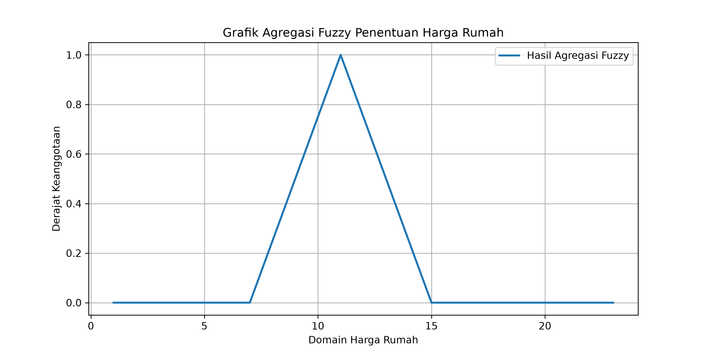
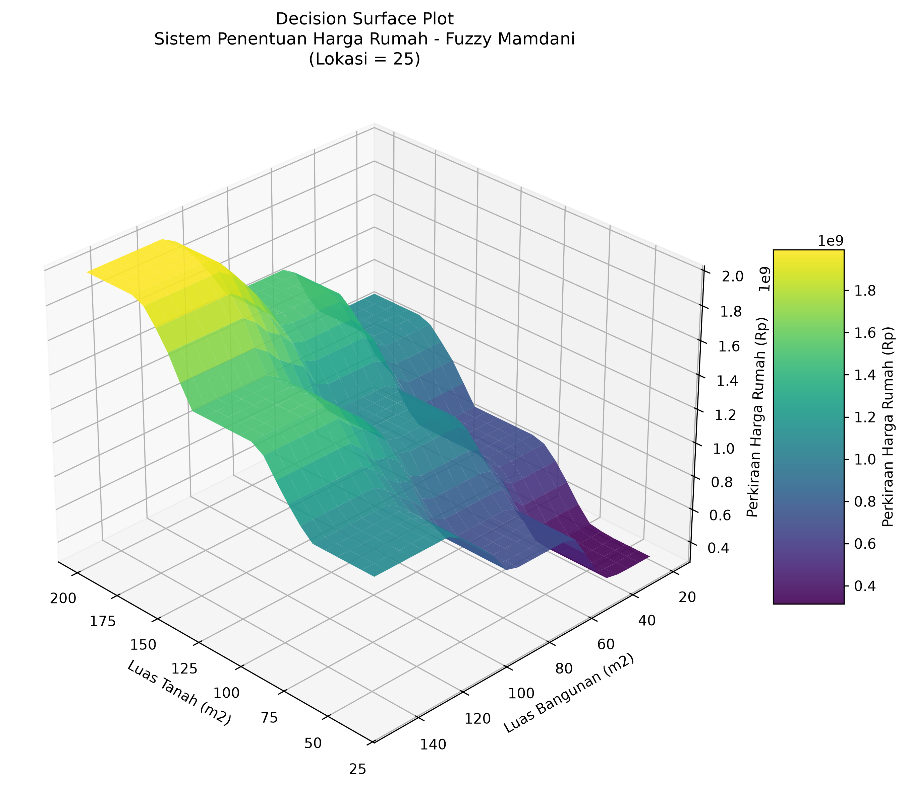

# LAPORAN ASESMEN MODUL 2
# FUZZY DECISION SYSTEM
## SISTEM PENENTUAN HARGA RUMAH MENGGUNAKAN METODE FUZZY MAMDANI

---

# 1. IDENTITAS DAN JUDUL PROYEK

**Nama:** Annisa Almaghvirah  
**NIM:** 240306037  
**Program Studi:** Teknologi Informasi  
**Perguruan Tinggi:** UIN Mataram  
**Dosen Pengampu:** Ahmad Ashril Rizal, M.Cs.  
**Tahun:** 2026

**Judul Proyek:** Sistem Penentuan Harga Rumah Menggunakan Metode Fuzzy Mamdani.

Proyek ini bertujuan untuk membangun sistem yang dapat memperkirakan harga rumah berdasarkan tiga variabel input, yaitu lokasi, luas tanah, dan luas bangunan. Sistem menggunakan metode Fuzzy Mamdani untuk mengolah nilai input melalui beberapa tahapan, mulai dari fuzzifikasi, inferensi, agregasi, hingga defuzzifikasi. Hasil akhirnya berupa nilai crisp yang dikonversi menjadi estimasi harga rumah dalam rupiah.

# 2. RINGKASAN MODEL VARIABEL FUZZY (REVIEW MODUL 1)

Pada sistem ini terdapat tiga variabel input dan satu variabel output. Setiap variabel memiliki beberapa himpunan fuzzy yang digunakan dalam proses perhitungan.

## 2.1 Variabel Input

### A. Lokasi

Variabel lokasi memiliki domain 0–50. Nilai ini digunakan sebagai skala penilaian tingkat strategis suatu lokasi, bukan jarak dalam kilometer. Semakin kecil nilai lokasi, semakin strategis lokasi tersebut.

| Himpunan Fuzzy | Bentuk Fungsi | Parameter |
|---|---|---|
| Sangat Strategis | Trapesium | [0, 0, 10, 20] |
| Strategis | Segitiga | [10, 25, 40] |
| Tidak Strategis | Trapesium | [30, 40, 50, 50] |

### B. Luas Tanah

Variabel luas tanah memiliki domain 36–200 m².

| Himpunan Fuzzy | Bentuk Fungsi | Parameter |
|---|---|---|
| Kecil | Trapesium | [36, 36, 60, 100] |
| Sedang | Segitiga | [72, 120, 168] |
| Luas | Trapesium | [140, 170, 200, 200] |

### C. Luas Bangunan

Variabel luas bangunan memiliki domain 21–150 m².

| Himpunan Fuzzy | Bentuk Fungsi | Parameter |
|---|---|---|
| Sempit | Trapesium | [21, 21, 36, 60] |
| Sedang | Segitiga | [45, 80, 115] |
| Luas | Trapesium | [90, 115, 150, 150] |

## 2.2 Variabel Output

Variabel output adalah harga rumah dengan domain 1–23. Variabel ini memiliki lima himpunan fuzzy.

| Himpunan Fuzzy | Bentuk Fungsi | Parameter |
|---|---|---|
| Sangat Murah | Trapesium | [1, 1, 3, 7] |
| Murah | Segitiga | [3, 7, 11] |
| Normal | Segitiga | [7, 11, 15] |
| Mahal | Segitiga | [11, 15, 19] |
| Sangat Mahal | Trapesium | [15, 19, 23, 23] |

Dalam proyek ini digunakan asumsi konversi satu satuan nilai output sama dengan Rp100.000.000. Oleh karena itu, hasil defuzzifikasi dikalikan dengan Rp100.000.000 untuk mendapatkan estimasi harga rumah dalam rupiah.

Nilai konversi tersebut merupakan asumsi yang digunakan dalam proyek, bukan harga pasar yang telah divalidasi.

# 3. PERANCANGAN BASIS ATURAN (RULE BASE MATRIX)

Basis aturan merupakan kumpulan aturan IF–THEN yang menghubungkan variabel input dengan variabel output. Aturan dibuat berdasarkan kombinasi himpunan fuzzy dari ketiga variabel input.

Setiap variabel input memiliki tiga himpunan fuzzy. Dengan demikian, jumlah kombinasi aturan yang digunakan adalah:

\[
3 \times 3 \times 3 = 27 \text{ aturan}
\]

## 3.1 Tabel Basis Aturan

| No. | Lokasi | Luas Tanah | Luas Bangunan | Harga Rumah |
|---|---|---|---|---|
| R01 | Sangat Strategis | Kecil | Sempit | Murah |
| R02 | Sangat Strategis | Kecil | Sedang | Normal |
| R03 | Sangat Strategis | Kecil | Luas | Mahal |
| R04 | Sangat Strategis | Sedang | Sempit | Normal |
| R05 | Sangat Strategis | Sedang | Sedang | Mahal |
| R06 | Sangat Strategis | Sedang | Luas | Sangat Mahal |
| R07 | Sangat Strategis | Luas | Sempit | Mahal |
| R08 | Sangat Strategis | Luas | Sedang | Sangat Mahal |
| R09 | Sangat Strategis | Luas | Luas | Sangat Mahal |
| R10 | Strategis | Kecil | Sempit | Sangat Murah |
| R11 | Strategis | Kecil | Sedang | Murah |
| R12 | Strategis | Kecil | Luas | Normal |
| R13 | Strategis | Sedang | Sempit | Murah |
| R14 | Strategis | Sedang | Sedang | Normal |
| R15 | Strategis | Sedang | Luas | Mahal |
| R16 | Strategis | Luas | Sempit | Normal |
| R17 | Strategis | Luas | Sedang | Mahal |
| R18 | Strategis | Luas | Luas | Sangat Mahal |
| R19 | Tidak Strategis | Kecil | Sempit | Sangat Murah |
| R20 | Tidak Strategis | Kecil | Sedang | Sangat Murah |
| R21 | Tidak Strategis | Kecil | Luas | Murah |
| R22 | Tidak Strategis | Sedang | Sempit | Sangat Murah |
| R23 | Tidak Strategis | Sedang | Sedang | Murah |
| R24 | Tidak Strategis | Sedang | Luas | Normal |
| R25 | Tidak Strategis | Luas | Sempit | Murah |
| R26 | Tidak Strategis | Luas | Sedang | Normal |
| R27 | Tidak Strategis | Luas | Luas | Mahal |

## 3.2 Aturan IF–THEN

Contoh aturan yang digunakan dalam sistem:

- **R01:** IF Lokasi Sangat Strategis AND Luas Tanah Kecil AND Luas Bangunan Sempit THEN Harga Rumah Murah.
- **R02:** IF Lokasi Sangat Strategis AND Luas Tanah Kecil AND Luas Bangunan Sedang THEN Harga Rumah Normal.
- **R03:** IF Lokasi Sangat Strategis AND Luas Tanah Kecil AND Luas Bangunan Luas THEN Harga Rumah Mahal.
- **R14:** IF Lokasi Strategis AND Luas Tanah Sedang AND Luas Bangunan Sedang THEN Harga Rumah Normal.
- **R27:** IF Lokasi Tidak Strategis AND Luas Tanah Luas AND Luas Bangunan Luas THEN Harga Rumah Mahal.

Aturan lainnya mengikuti kombinasi yang terdapat pada tabel basis aturan.

## 3.3 Penjelasan Basis Aturan

Basis aturan dibuat dengan mempertimbangkan hubungan antara tingkat strategis lokasi, luas tanah, dan luas bangunan terhadap harga rumah.

Lokasi yang lebih strategis serta ukuran tanah dan bangunan yang lebih besar cenderung menghasilkan estimasi harga yang lebih tinggi. Sebaliknya, lokasi yang kurang strategis dan ukuran rumah yang lebih kecil cenderung menghasilkan estimasi harga yang lebih rendah.

# 4. METODE INFERENSI DAN JUSTIFIKASI PEMILIHAN

Metode yang digunakan dalam proyek ini adalah Fuzzy Mamdani. Metode ini dipilih karena dapat mengolah nilai input ke dalam beberapa himpunan fuzzy dan menghasilkan keputusan berdasarkan aturan IF–THEN.

Metode Mamdani juga memudahkan proses penjelasan karena setiap aturan memiliki hubungan yang jelas antara kondisi input dan hasil output.

## 4.1 Tahapan Inferensi Fuzzy Mamdani

### A. Fuzzifikasi

Fuzzifikasi merupakan proses mengubah nilai input numerik menjadi derajat keanggotaan pada setiap himpunan fuzzy.

Pada sistem ini, nilai lokasi, luas tanah, dan luas bangunan dihitung menggunakan fungsi keanggotaan trapesium dan segitiga.

### B. Operasi AND

Operasi AND digunakan untuk menentukan kekuatan setiap aturan. Sistem menggunakan operator MIN, yaitu mengambil nilai keanggotaan terkecil dari seluruh kondisi dalam satu aturan.

### C. Implikasi

Implikasi digunakan untuk membentuk keluaran dari setiap aturan yang aktif. Metode yang digunakan adalah MIN, yaitu memotong fungsi keanggotaan output berdasarkan nilai kekuatan aturan.

### D. Agregasi

Agregasi merupakan proses menggabungkan seluruh keluaran aturan yang aktif menjadi satu himpunan fuzzy. Pada tahap ini digunakan operator MAX, yaitu mengambil nilai maksimum dari hasil setiap aturan.

### E. Defuzzifikasi

Defuzzifikasi merupakan proses mengubah hasil agregasi fuzzy menjadi nilai tegas atau crisp. Metode yang digunakan adalah Centroid dengan pendekatan diskrit untuk memperoleh satu nilai output.

## 4.2 Pengaturan Operator Fuzzy

| Tahapan | Metode yang Digunakan |
|---|---|
| AND | MIN |
| Implikasi | MIN |
| Agregasi | MAX |
| Defuzzifikasi | Centroid |

# 5. IMPLEMENTASI PROGRAM PYTHON (FULL CODE & PENJELASAN)

Implementasi sistem dilakukan menggunakan bahasa pemrograman Python. Program dibuat untuk menerima tiga nilai input, memproses data menggunakan metode Fuzzy Mamdani, dan menghasilkan estimasi harga rumah.

## 5.1 Library yang Digunakan

Program menggunakan beberapa library berikut:

```python
import numpy as np
import pandas as pd
import matplotlib.pyplot as plt
```

Penjelasan:

1. `numpy` digunakan untuk melakukan perhitungan numerik, membuat array, serta menghitung derajat keanggotaan.
2. `pandas` digunakan sebagai library pendukung pengolahan data.
3. `matplotlib.pyplot` digunakan untuk membuat dan menampilkan grafik hasil perhitungan fuzzy.

## 5.2 Fungsi Keanggotaan Fuzzy

Fungsi keanggotaan digunakan untuk menentukan derajat keanggotaan suatu nilai terhadap himpunan fuzzy. Pada program ini digunakan dua bentuk fungsi keanggotaan, yaitu trapesium dan segitiga.

### A. Fungsi Keanggotaan Trapesium

```python
def trapezoid(x, a, b, c, d):
    x = np.asarray(x, dtype=float)

    rising = (
        np.ones_like(x)
        if a == b
        else np.clip((x - a) / (b - a), 0, 1)
    )

    falling = (
        np.ones_like(x)
        if c == d
        else np.clip((d - x) / (d - c), 0, 1)
    )

    return np.minimum(rising, falling)
```

Penjelasan:

Fungsi `trapezoid()` digunakan untuk menghitung derajat keanggotaan berbentuk trapesium. Parameter `a`, `b`, `c`, dan `d` merupakan titik-titik pembentuk fungsi keanggotaan.

- `np.asarray()` mengubah nilai input menjadi array numerik.
- `rising` menghitung bagian kenaikan derajat keanggotaan.
- `falling` menghitung bagian penurunan derajat keanggotaan.
- `np.clip()` membatasi hasil perhitungan pada rentang 0 sampai 1.
- `np.minimum()` mengambil nilai terkecil dari bagian kenaikan dan penurunan.

### B. Fungsi Keanggotaan Segitiga

```python
def triangle(x, a, b, c):
    x = np.asarray(x, dtype=float)

    rising = np.clip((x - a) / (b - a), 0, 1)
    falling = np.clip((c - x) / (c - b), 0, 1)

    return np.minimum(rising, falling)
```

Penjelasan:

Fungsi `triangle()` digunakan untuk menghitung derajat keanggotaan berbentuk segitiga.

- `a` merupakan titik awal fungsi.
- `b` merupakan titik puncak dengan derajat keanggotaan 1.
- `c` merupakan titik akhir fungsi.
- `rising` menghitung kenaikan derajat keanggotaan.
- `falling` menghitung penurunan derajat keanggotaan.
- `np.minimum()` mengambil nilai terkecil dari kedua hasil perhitungan.

## 5.3 Menentukan Domain Variabel Output

```python
domain_harga = np.linspace(1, 23, 221)
```

Penjelasan:

Variabel `domain_harga` digunakan untuk menentukan rentang nilai output harga rumah dari 1 sampai 23. Fungsi `np.linspace()` membagi rentang tersebut menjadi 221 titik nilai.

Domain ini digunakan dalam pembentukan fungsi keanggotaan output, proses agregasi, dan defuzzifikasi.

## 5.4 Fungsi Fuzzifikasi Variabel Input

Fuzzifikasi merupakan proses mengubah nilai input numerik menjadi derajat keanggotaan pada setiap himpunan fuzzy.

### A. Fuzzifikasi Lokasi

```python
def fuzzifikasi_lokasi(nilai):
    return {
        "Sangat Strategis": float(
            trapezoid(nilai, 0, 0, 10, 20)
        ),
        "Strategis": float(
            triangle(nilai, 10, 25, 40)
        ),
        "Tidak Strategis": float(
            trapezoid(nilai, 30, 40, 50, 50)
        )
    }
```

Penjelasan:

Fungsi ini menghitung derajat keanggotaan nilai lokasi ke dalam tiga himpunan, yaitu Sangat Strategis, Strategis, dan Tidak Strategis. Setiap himpunan menggunakan parameter fungsi keanggotaan yang telah ditentukan.

### B. Fuzzifikasi Luas Tanah

```python
def fuzzifikasi_tanah(nilai):
    return {
        "Kecil": float(
            trapezoid(nilai, 36, 36, 60, 100)
        ),
        "Sedang": float(
            triangle(nilai, 72, 120, 168)
        ),
        "Luas": float(
            trapezoid(nilai, 140, 170, 200, 200)
        )
    }
```

Penjelasan:

Fungsi ini menghitung derajat keanggotaan luas tanah ke dalam tiga himpunan, yaitu Kecil, Sedang, dan Luas. Rentang nilai yang digunakan adalah 36 sampai 200 m².

### C. Fuzzifikasi Luas Bangunan

```python
def fuzzifikasi_bangunan(nilai):
    return {
        "Sempit": float(
            trapezoid(nilai, 21, 21, 36, 60)
        ),
        "Sedang": float(
            triangle(nilai, 45, 80, 115)
        ),
        "Luas": float(
            trapezoid(nilai, 90, 115, 150, 150)
        )
    }
```

Penjelasan:

Fungsi ini menghitung derajat keanggotaan luas bangunan ke dalam tiga himpunan, yaitu Sempit, Sedang, dan Luas. Rentang nilai yang digunakan adalah 21 sampai 150 m².

## 5.5 Fungsi Keanggotaan Variabel Output

```python
def fungsi_output():
    return {
        "Sangat Murah": trapezoid(
            domain_harga, 1, 1, 3, 7
        ),
        "Murah": triangle(
            domain_harga, 3, 7, 11
        ),
        "Normal": triangle(
            domain_harga, 7, 11, 15
        ),
        "Mahal": triangle(
            domain_harga, 11, 15, 19
        ),
        "Sangat Mahal": trapezoid(
            domain_harga, 15, 19, 23, 23
        )
    }
```

Penjelasan:

Fungsi `fungsi_output()` digunakan untuk membentuk lima himpunan fuzzy pada variabel harga rumah, yaitu Sangat Murah, Murah, Normal, Mahal, dan Sangat Mahal.

Fungsi ini menghasilkan derajat keanggotaan setiap himpunan berdasarkan domain harga yang telah dibuat.

## 5.6 Basis Aturan Fuzzy (Rule Base)

```python
aturan = [
    # Lokasi Sangat Strategis
    ("Sangat Strategis", "Kecil", "Sempit", "Murah"),
    ("Sangat Strategis", "Kecil", "Sedang", "Normal"),
    ("Sangat Strategis", "Kecil", "Luas", "Mahal"),
    ("Sangat Strategis", "Sedang", "Sempit", "Normal"),
    ("Sangat Strategis", "Sedang", "Sedang", "Mahal"),
    ("Sangat Strategis", "Sedang", "Luas", "Sangat Mahal"),
    ("Sangat Strategis", "Luas", "Sempit", "Mahal"),
    ("Sangat Strategis", "Luas", "Sedang", "Sangat Mahal"),
    ("Sangat Strategis", "Luas", "Luas", "Sangat Mahal"),

    # Lokasi Strategis
    ("Strategis", "Kecil", "Sempit", "Sangat Murah"),
    ("Strategis", "Kecil", "Sedang", "Murah"),
    ("Strategis", "Kecil", "Luas", "Normal"),
    ("Strategis", "Sedang", "Sempit", "Murah"),
    ("Strategis", "Sedang", "Sedang", "Normal"),
    ("Strategis", "Sedang", "Luas", "Mahal"),
    ("Strategis", "Luas", "Sempit", "Normal"),
    ("Strategis", "Luas", "Sedang", "Mahal"),
    ("Strategis", "Luas", "Luas", "Sangat Mahal"),

    # Lokasi Tidak Strategis
    ("Tidak Strategis", "Kecil", "Sempit", "Sangat Murah"),
    ("Tidak Strategis", "Kecil", "Sedang", "Sangat Murah"),
    ("Tidak Strategis", "Kecil", "Luas", "Murah"),
    ("Tidak Strategis", "Sedang", "Sempit", "Sangat Murah"),
    ("Tidak Strategis", "Sedang", "Sedang", "Murah"),
    ("Tidak Strategis", "Sedang", "Luas", "Normal"),
    ("Tidak Strategis", "Luas", "Sempit", "Murah"),
    ("Tidak Strategis", "Luas", "Sedang", "Normal"),
    ("Tidak Strategis", "Luas", "Luas", "Mahal")
]
```

Penjelasan:

Variabel `aturan` berisi 27 aturan fuzzy yang menghubungkan tiga variabel input dengan satu variabel output.

Setiap aturan memiliki empat bagian, yaitu kategori lokasi, kategori luas tanah, kategori luas bangunan, dan hasil harga rumah.

Contohnya, aturan pertama menyatakan bahwa jika lokasi Sangat Strategis, luas tanah Kecil, dan luas bangunan Sempit, maka hasil harga rumah adalah Murah.

Seluruh aturan akan dievaluasi oleh sistem untuk menentukan hasil estimasi harga rumah.

## 5.7 Proses Inferensi Fuzzy Mamdani

```python
def evaluasi_sistem_fuzzy(lokasi, tanah, bangunan):

    # Validasi nilai input
    if not 0 <= lokasi <= 50:
        raise ValueError("Lokasi harus berada pada rentang 0-50.")

    if not 36 <= tanah <= 200:
        raise ValueError("Luas tanah harus berada pada rentang 36-200.")

    if not 21 <= bangunan <= 150:
        raise ValueError("Luas bangunan harus berada pada rentang 21-150.")

    # Fuzzifikasi setiap variabel
    fuzzy_lokasi = fuzzifikasi_lokasi(lokasi)
    fuzzy_tanah = fuzzifikasi_tanah(tanah)
    fuzzy_bangunan = fuzzifikasi_bangunan(bangunan)

    # Fungsi keanggotaan output
    output_fuzzy = fungsi_output()

    # Menyiapkan agregasi
    agregasi = np.zeros_like(domain_harga)

    # Evaluasi 27 aturan
    for label_lokasi, label_tanah, label_bangunan, hasil in aturan:

        # Operator AND menggunakan MIN
        alpha = min(
            fuzzy_lokasi[label_lokasi],
            fuzzy_tanah[label_tanah],
            fuzzy_bangunan[label_bangunan]
        )

        # Implikasi menggunakan MIN
        hasil_implikasi = np.minimum(
            alpha,
            output_fuzzy[hasil]
        )

        # Agregasi menggunakan MAX
        agregasi = np.maximum(
            agregasi,
            hasil_implikasi
        )

    # Defuzzifikasi menggunakan Centroid
    luas_area = np.sum(agregasi)

    if luas_area == 0:
        raise ValueError(
            "Tidak ada aturan fuzzy yang aktif untuk input tersebut."
        )

    nilai_crisp = np.sum(
        domain_harga * agregasi
    ) / luas_area

    return nilai_crisp, agregasi
```

Penjelasan:

Fungsi `evaluasi_sistem_fuzzy()` merupakan bagian utama sistem karena menjalankan proses inferensi Fuzzy Mamdani hingga menghasilkan nilai crisp.

Tahapan yang dilakukan adalah:

1. **Validasi input:** Memastikan nilai lokasi, luas tanah, dan luas bangunan berada dalam rentang yang telah ditentukan.
2. **Fuzzifikasi:** Mengubah setiap nilai input menjadi derajat keanggotaan fuzzy.
3. **Menyiapkan output:** Memanggil fungsi keanggotaan output dan membuat array agregasi yang awalnya bernilai nol.
4. **Evaluasi aturan:** Melakukan perhitungan terhadap seluruh 27 aturan yang tersedia.
5. **Operator AND:** Menggunakan MIN untuk mendapatkan nilai kekuatan aturan atau alpha-predikat.
6. **Implikasi:** Menggunakan MIN untuk memotong fungsi keanggotaan output berdasarkan kekuatan aturan.
7. **Agregasi:** Menggunakan MAX untuk menggabungkan seluruh hasil implikasi.
8. **Defuzzifikasi:** Menggunakan metode Centroid dengan pendekatan diskrit untuk memperoleh satu nilai crisp.

Pada bagian defuzzifikasi, `luas_area` digunakan untuk menjumlahkan seluruh derajat keanggotaan hasil agregasi. Jika nilainya nol, program menampilkan pesan kesalahan karena tidak ada aturan yang aktif.

Rumus Centroid yang digunakan adalah:

\[
Z^*=\frac{\sum_{i=1}^{n}z_i\mu(z_i)}
{\sum_{i=1}^{n}\mu(z_i)}
\]

Keterangan:

- \(Z^*\) = nilai hasil defuzzifikasi.
- \(z_i\) = nilai pada domain output.
- \(\mu(z_i)\) = derajat keanggotaan hasil agregasi.
- \(n\) = jumlah titik pada domain output.

Fungsi kemudian mengembalikan dua nilai, yaitu hasil defuzzifikasi dan array agregasi.

## 5.8 Input Data Rumah dari Pengguna

```python
print("==============================================")
print(" SISTEM PENDUKUNG KEPUTUSAN PENENTUAN HARGA RUMAH")
print("             METODE FUZZY MAMDANI")
print("==============================================")

lokasi = float(input("Masukkan nilai lokasi (0-50): "))
tanah = float(input("Masukkan luas tanah (36-200) m2: "))
bangunan = float(input("Masukkan luas bangunan (21-150) m2: "))
```

Penjelasan:

Bagian ini digunakan untuk menerima data rumah yang dimasukkan oleh pengguna melalui terminal. Terdapat tiga input yang harus dimasukkan, yaitu nilai lokasi, luas tanah, dan luas bangunan.

Fungsi `input()` digunakan untuk menerima masukan, sedangkan `float()` mengubah masukan menjadi tipe data numerik agar dapat diproses oleh sistem.

## 5.9 Menampilkan Hasil Penentuan Harga Rumah

```python
hasil, agregasi = evaluasi_sistem_fuzzy(
    lokasi, tanah, bangunan
)

# Konversi nilai output menjadi rupiah
harga_rumah = hasil * 100_000_000

print("\n========== HASIL PENENTUAN HARGA ==========")
print(f"Nilai Lokasi        : {lokasi}")
print(f"Luas Tanah          : {tanah} m2")
print(f"Luas Bangunan       : {bangunan} m2")
print(f"Nilai Defuzzifikasi : {hasil:.2f}")
print(f"Perkiraan Harga     : Rp{harga_rumah:,.0f}")
print("===========================================")
```

Penjelasan:

Bagian ini memanggil fungsi `evaluasi_sistem_fuzzy()` untuk memproses seluruh input yang telah dimasukkan pengguna.

Hasil perhitungan disimpan dalam variabel `hasil`, sedangkan hasil agregasi disimpan dalam variabel `agregasi`.

Nilai defuzzifikasi kemudian dikalikan dengan 100.000.000 untuk mendapatkan estimasi harga rumah dalam rupiah. Setelah itu, program menampilkan data input, nilai defuzzifikasi, dan perkiraan harga rumah.

## 5.10 Menampilkan Grafik Agregasi

```python
plt.figure(figsize=(10, 5))

plt.plot(
    domain_harga,
    agregasi,
    label="Hasil Agregasi Fuzzy",
    linewidth=2
)

plt.title(
    "Grafik Agregasi Fuzzy Penentuan Harga Rumah"
)
plt.xlabel("Domain Harga Rumah")
plt.ylabel("Derajat Keanggotaan")
plt.grid(True)
plt.legend()

plt.savefig(
    "grafik_agregasi_harga_rumah.png",
    dpi=300
)

plt.show()
```

Penjelasan:

Bagian ini digunakan untuk menampilkan grafik hasil agregasi fuzzy. Grafik menunjukkan hubungan antara domain harga rumah dengan derajat keanggotaan setelah seluruh aturan fuzzy digabungkan.

- `plt.figure()` digunakan untuk menentukan ukuran grafik.
- `plt.plot()` digunakan untuk menggambar grafik agregasi.
- `plt.title()` memberikan judul grafik.
- `plt.xlabel()` dan `plt.ylabel()` memberikan keterangan sumbu.
- `plt.grid()` menampilkan garis bantu.
- `plt.legend()` menampilkan keterangan grafik.
- `plt.savefig()` menyimpan grafik dalam format PNG dengan resolusi 300 DPI.
- `plt.show()` menampilkan grafik ke layar.

## 5.11 Visualisasi Decision Surface Plot 3D

```python
import matplotlib.pyplot as plt
from mpl_toolkits.mplot3d import Axes3D

# Menentukan nilai lokasi tetap
lokasi_tetap = 25

# Membuat rentang nilai luas tanah dan luas bangunan
tanah_range = np.linspace(36, 200, 25)
bangunan_range = np.linspace(21, 150, 25)

# Membuat grid untuk grafik 3D
X, Y = np.meshgrid(tanah_range, bangunan_range)

# Menyiapkan tempat untuk hasil harga rumah
Z = np.zeros_like(X)

# Menghitung harga rumah pada setiap kombinasi input
for i in range(X.shape[0]):
    for j in range(X.shape[1]):

        hasil, _ = evaluasi_sistem_fuzzy(
            lokasi_tetap,
            X[i, j],
            Y[i, j]
        )

        # Konversi hasil ke rupiah
        Z[i, j] = hasil * 100_000_000


# Membuat grafik 3D
fig = plt.figure(figsize=(11, 8))
ax = fig.add_subplot(111, projection='3d')

surf = ax.plot_surface(
    X,
    Y,
    Z,
    cmap='viridis',
    edgecolor='none',
    alpha=0.9
)

# Memberikan label pada grafik
ax.set_xlabel('Luas Tanah (m2)')
ax.set_ylabel('Luas Bangunan (m2)')
ax.set_zlabel('Perkiraan Harga Rumah (Rp)')

ax.set_title(
    'Decision Surface Plot\n'
    'Sistem Penentuan Harga Rumah - Fuzzy Mamdani\n'
    '(Lokasi = 25)'
)

# Menambahkan skala warna
fig.colorbar(
    surf,
    ax=ax,
    shrink=0.5,
    aspect=5,
    label='Perkiraan Harga Rumah (Rp)'
)

# Mengatur sudut pandang grafik
ax.view_init(elev=30, azim=135)

plt.tight_layout()

# Menyimpan grafik
plt.savefig(
    'decision_surface_harga_rumah.png',
    dpi=300,
    bbox_inches='tight'
)

# Menampilkan grafik
plt.show()
```

Penjelasan:

Bagian ini digunakan untuk membuat visualisasi decision surface dalam bentuk grafik tiga dimensi. Grafik memperlihatkan hubungan antara luas tanah, luas bangunan, dan estimasi harga rumah.

Tahapan yang dilakukan adalah:

1. Menentukan nilai lokasi tetap sebesar 25 agar pengaruh luas tanah dan luas bangunan dapat diamati pada kondisi lokasi yang sama.
2. Membuat rentang luas tanah dari 36 sampai 200 m² sebanyak 25 titik.
3. Membuat rentang luas bangunan dari 21 sampai 150 m² sebanyak 25 titik.
4. Menggunakan `np.meshgrid()` untuk membentuk kombinasi nilai luas tanah dan luas bangunan.
5. Menggunakan perulangan untuk menghitung hasil defuzzifikasi pada setiap kombinasi input.
6. Mengalikan hasil defuzzifikasi dengan 100.000.000 agar nilai output menjadi rupiah.
7. Menggunakan `plot_surface()` untuk membuat grafik permukaan tiga dimensi.
8. Menambahkan label, judul, skala warna, dan sudut pandang grafik.
9. Menyimpan grafik dengan nama `decision_surface_harga_rumah.png`.

Jumlah kombinasi yang diuji adalah:

\[
25 \times 25 = 625 \text{ kombinasi}
\]

## 5.12 Pengujian Lima Skenario Kasus Rumah

```python
skenario = [
    {
        "Nama": "Skenario 1",
        "Kondisi": "Lokasi sangat strategis, ukuran kecil",
        "Lokasi": 5,
        "Tanah": 50,
        "Bangunan": 30
    },
    {
        "Nama": "Skenario 2",
        "Kondisi": "Lokasi tidak strategis, ukuran kecil",
        "Lokasi": 45,
        "Tanah": 50,
        "Bangunan": 30
    },
    {
        "Nama": "Skenario 3",
        "Kondisi": "Lokasi strategis, ukuran sedang",
        "Lokasi": 25,
        "Tanah": 120,
        "Bangunan": 80
    },
    {
        "Nama": "Skenario 4",
        "Kondisi": "Lokasi sangat strategis, ukuran besar",
        "Lokasi": 10,
        "Tanah": 180,
        "Bangunan": 130
    },
    {
        "Nama": "Skenario 5",
        "Kondisi": "Lokasi tidak strategis, ukuran besar",
        "Lokasi": 45,
        "Tanah": 180,
        "Bangunan": 130
    }
]

print("\n==============================================")
print(" HASIL PENGUJIAN 5 SKENARIO HARGA RUMAH")
print("==============================================")

for data in skenario:

    hasil, agregasi = evaluasi_sistem_fuzzy(
        data["Lokasi"],
        data["Tanah"],
        data["Bangunan"]
    )

    harga_rumah = hasil * 100_000_000

    print(f"\n{data['Nama']}")
    print(f"Kondisi             : {data['Kondisi']}")
    print(f"Lokasi              : {data['Lokasi']}")
    print(f"Luas Tanah          : {data['Tanah']} m2")
    print(f"Luas Bangunan       : {data['Bangunan']} m2")
    print(f"Nilai Defuzzifikasi : {hasil:.2f}")
    print(f"Perkiraan Harga     : Rp{harga_rumah:,.0f}")

print("\n==============================================")
print(" PENGUJIAN SELESAI")
print("==============================================")
```

Penjelasan:

Bagian terakhir digunakan untuk melakukan pengujian terhadap lima skenario rumah dengan kondisi input yang berbeda.

Data pengujian disimpan dalam variabel `skenario` yang berbentuk list berisi beberapa dictionary. Setiap dictionary memiliki nama skenario, kondisi rumah, nilai lokasi, luas tanah, dan luas bangunan.

Perulangan `for` digunakan untuk membaca setiap data skenario dan mengirimkan nilai input ke fungsi `evaluasi_sistem_fuzzy()`.

Setelah proses perhitungan selesai, nilai defuzzifikasi dikalikan dengan 100.000.000 untuk mendapatkan estimasi harga rumah dalam rupiah. Hasil setiap skenario kemudian ditampilkan melalui terminal.

## 5.13 Kesimpulan Implementasi Program

Berdasarkan implementasi yang telah dilakukan, program berhasil menggabungkan tahapan utama Fuzzy Mamdani, mulai dari fungsi keanggotaan, fuzzifikasi, evaluasi 27 aturan, implikasi, agregasi, hingga defuzzifikasi.

Program juga dilengkapi dengan input data rumah, tampilan hasil estimasi harga, grafik agregasi, decision surface tiga dimensi, dan pengujian lima skenario.

Dengan demikian, program dapat digunakan untuk memperkirakan harga rumah berdasarkan nilai lokasi, luas tanah, dan luas bangunan sesuai dengan aturan fuzzy yang telah dirancang.

# 6. HASIL PENGUJIAN DAN ANALISIS DECISION SURFACE

Pengujian dilakukan untuk mengetahui apakah sistem dapat menghasilkan estimasi harga rumah berdasarkan nilai input yang diberikan. Pengujian meliputi grafik agregasi, decision surface, dan lima skenario kasus rumah.

## 6.1 Grafik Agregasi

Grafik agregasi digunakan untuk menampilkan hasil penggabungan seluruh aturan fuzzy yang aktif. Grafik ini menunjukkan bentuk himpunan fuzzy output sebelum dilakukan proses defuzzifikasi.

Program menyimpan grafik dengan nama `grafik_agregasi_harga_rumah.png`.

**Gambar 1. Grafik Agregasi Fuzzy Penentuan Harga Rumah**



Berdasarkan grafik agregasi, dapat dilihat hasil penggabungan keluaran dari aturan-aturan fuzzy yang aktif. Bentuk grafik tersebut menjadi dasar untuk memperoleh nilai crisp melalui proses defuzzifikasi.

## 6.2 Decision Surface Plot 3D

Decision surface digunakan untuk melihat hubungan antara luas tanah dan luas bangunan terhadap estimasi harga rumah. Pada visualisasi ini, nilai lokasi ditetapkan sebesar 25, sedangkan luas tanah dan luas bangunan dibuat dalam beberapa kombinasi nilai.

Pengujian menggunakan 25 variasi nilai luas tanah dan 25 variasi nilai luas bangunan sehingga menghasilkan 625 kombinasi pengujian.

Program menyimpan grafik dengan nama `decision_surface_harga_rumah.png`.

**Gambar 2. Decision Surface Sistem Penentuan Harga Rumah**



Grafik tersebut memperlihatkan perubahan estimasi harga rumah berdasarkan perubahan luas tanah dan luas bangunan pada nilai lokasi yang telah ditetapkan.

## 6.3 Hasil Pengujian Lima Skenario

Pengujian dilakukan menggunakan lima skenario dengan kombinasi nilai lokasi, luas tanah, dan luas bangunan yang berbeda.

| Skenario | Lokasi | Luas Tanah (m²) | Luas Bangunan (m²) | Defuzzifikasi | Estimasi Harga |
|---|---:|---:|---:|---:|---:|
| 1 | 5 | 50 | 30 | 7,00 | Rp700.000.000 |
| 2 | 45 | 50 | 30 | 3,14 | Rp313.950.617 |
| 3 | 25 | 120 | 80 | 11,00 | Rp1.100.000.000 |
| 4 | 10 | 180 | 130 | 19,91 | Rp1.991.487.603 |
| 5 | 45 | 180 | 130 | 15,00 | Rp1.500.000.000 |

## 6.4 Analisis Hasil Pengujian

Berdasarkan hasil pengujian, setiap kombinasi input menghasilkan estimasi harga rumah yang berbeda.

Pada skenario pertama, rumah dengan lokasi bernilai 5, luas tanah 50 m², dan luas bangunan 30 m² menghasilkan estimasi harga sebesar Rp700.000.000.

Sementara itu, skenario kedua menggunakan luas tanah dan luas bangunan yang sama, tetapi nilai lokasinya 45. Hasil estimasi harganya menjadi lebih rendah, yaitu Rp313.950.617.

Pada skenario ketiga, dengan lokasi 25, luas tanah 120 m², dan luas bangunan 80 m², sistem menghasilkan estimasi harga sebesar Rp1.100.000.000.

Skenario keempat menghasilkan estimasi harga tertinggi, yaitu Rp1.991.487.603. Hal ini dipengaruhi oleh lokasi yang sangat strategis serta ukuran tanah dan bangunan yang besar.

Pada skenario kelima, luas tanah dan luas bangunan sama dengan skenario keempat, tetapi nilai lokasinya berbeda. Hasil estimasi harga menjadi Rp1.500.000.000.

Perbandingan skenario pertama dengan kedua serta skenario keempat dengan kelima menunjukkan bahwa perbedaan nilai lokasi dapat memengaruhi hasil estimasi harga rumah meskipun luas tanah dan luas bangunannya sama.

Secara keseluruhan, hasil pengujian menunjukkan bahwa ketiga variabel input, yaitu lokasi, luas tanah, dan luas bangunan, memengaruhi estimasi harga rumah berdasarkan aturan fuzzy yang telah dirancang.

# 7. RENCANA INTEGRASI KE APLIKASI WEB (TAHAP MODUL 3)

Pada Modul 3, sistem penentuan harga rumah direncanakan untuk dikembangkan menjadi aplikasi berbasis web menggunakan Streamlit.

Rencana integrasi meliputi penyediaan halaman input untuk memasukkan nilai lokasi, luas tanah, dan luas bangunan. Selanjutnya, input pengguna akan dihubungkan dengan fungsi evaluasi_sistem_fuzzy() agar data diproses menggunakan metode Fuzzy Mamdani berdasarkan 27 aturan yang tersedia.

Hasil perhitungan berupa nilai defuzzifikasi dan estimasi harga rumah dalam rupiah akan ditampilkan pada halaman hasil. Dengan integrasi tersebut, pengguna dapat memperoleh estimasi harga rumah melalui aplikasi web tanpa harus menjalankan program Python secara langsung.


